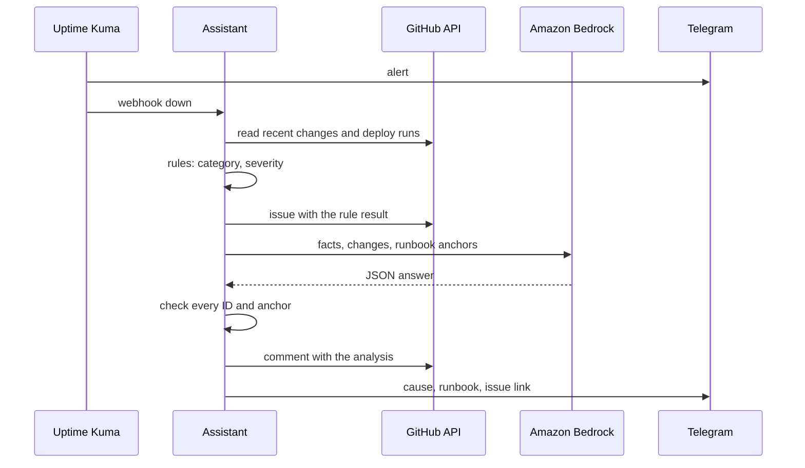

# vps-incident-assistant

Incident assistant for the VPS platform: turns Uptime Kuma alerts into GitHub issues with rule-based triage and a checked LLM analysis.

[](https://github.com/PhilippKlinger/vps-incident-assistant/actions/workflows/ci.yml)
[](https://github.com/PhilippKlinger/vps-incident-assistant/actions/workflows/security.yml)
[](https://github.com/PhilippKlinger/vps-incident-assistant/actions/workflows/codeql.yml)
[](https://scorecard.dev/viewer/?uri=github.com/PhilippKlinger/vps-incident-assistant)
[](LICENSE)

## Overview

- Turns Uptime Kuma alerts into GitHub issues: one issue per incident, later alerts become comments
- Rules set category and severity; an LLM on Amazon Bedrock suggests the causing change and a runbook section
- Every claim of the LLM is checked against the supplied facts before it is published; a human decides what to do
- Reads only public repositories and writes only issues and Telegram messages

## How it works



The runbook sections come from `RUNBOOK.md` in [vps-edge](https://github.com/PhilippKlinger/vps-edge), [vps-monitoring](https://github.com/PhilippKlinger/vps-monitoring) and [videoflix-deploy](https://github.com/PhilippKlinger/videoflix-deploy).

## Tech stack

- Python 3.13, FastAPI, httpx, Pydantic
- Claude Sonnet 4.6 on Amazon Bedrock
- Docker Compose

## Getting started

```bash
python -m venv .venv
source .venv/bin/activate   # Windows: .venv/Scripts/activate
pip install -r requirements-dev.txt
ruff check . && pytest
```

## Results

30 frozen incidents with a reference answer, scored against two baselines (the most recent change, a keyword match), with thresholds fixed before the run. Full numbers: [report](evals/reports/2026-11-12-sonnet-4-6.md).

| Metric | Best baseline | Claude Sonnet 4.6 | Threshold |
|---|---|---|---|
| Change hit | 39.1 % | 95.7 % | 15 pp above the baseline: pass |
| Runbook hit | 23.8 % | 76.2 % | 15 pp above the baseline: pass |
| Correct none (runbook) | 100 % | 33.3 % | at least 80 %: fail |
| Latency p95 | n/a | 5.4 s | under 300 s: pass |

The missed threshold only affects the runbook suggestion, which stays a suggestion next to the rule result.

## CI and security

- **Lint and tests:** ruff, pytest, evals on the fixtures and baselines
- **Stack:** compose validation, a real start with the hardening checks (non-root, read-only filesystem, dropped capabilities, no published ports), Trivy scan of the images
- **Security checks:** secret scan (gitleaks), workflow lint (zizmor), CodeQL for Python and the workflows; provenance and SBOM of the published image
- **Prompt injection:** foreign text goes into the prompt only as marked data, the only tool is the output schema and nothing is executed
- **Data protection:** the analysis runs in the EU and gets only public data, no personal data

All checks are required before a merge.

## Related repositories

| Repository | Role |
|---|---|
| [vps-monitoring](https://github.com/PhilippKlinger/vps-monitoring) | Uptime Kuma sends the alert webhook; runbook source (RUNBOOK.md) |
| [vps-edge](https://github.com/PhilippKlinger/vps-edge) | Runbook source (RUNBOOK.md), read for changes |
| [videoflix-deploy](https://github.com/PhilippKlinger/videoflix-deploy) | Runbook source (RUNBOOK.md), read for changes |
| [videoflix-backend](https://github.com/PhilippKlinger/videoflix-backend), [videoflix-frontend](https://github.com/PhilippKlinger/videoflix-frontend) | Read for changes |
| [v-server-setup](https://github.com/PhilippKlinger/v-server-setup) | How the server is set up and hardened |

## License

[MIT](LICENSE)
