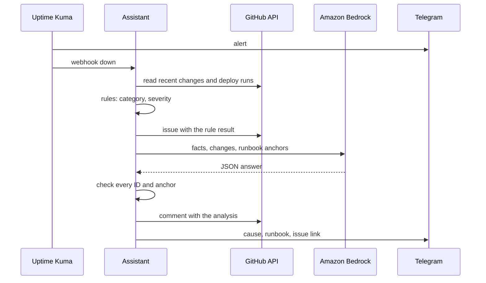

# vps-incident-assistant

Incident assistant for the VPS platform: turns Uptime Kuma alerts into GitHub issues with rule-based triage and a checked LLM analysis.

[](https://github.com/PhilippKlinger/vps-incident-assistant/actions/workflows/ci.yml)
[](https://github.com/PhilippKlinger/vps-incident-assistant/actions/workflows/security.yml)
[](https://github.com/PhilippKlinger/vps-incident-assistant/actions/workflows/codeql.yml)
[](https://scorecard.dev/viewer/?uri=github.com/PhilippKlinger/vps-incident-assistant)
[](LICENSE)

When a service goes down, the alert alone does not say what changed or where to look. The assistant collects the facts around the alert, files one issue per incident and adds a suspected cause and a matching runbook section, both backed by evidence. Rules decide category and severity; the LLM only suggests the cause, and the code checks every claim before it is published. A human decides what to do; the assistant only reads, and writes issues and Telegram messages.

The LLM analysis is switched on (`llm.enabled = true` in `config.toml`). In the [evaluation](#evaluation) Claude Sonnet 4.6 on Amazon Bedrock met six of seven thresholds against 30 frozen incidents: it names the causing change in 96 % of the cases, against 39 % for the best baseline. Known weakness: when no runbook section applies, it still suggests one too often (33 % correct `none` instead of at least 80 %), so the runbook link is a suggestion next to the rule result.

## How it works



**Rules vs. LLM.** Rules produce category and severity. The LLM never does; it only fills a fixed schema: `suspected_change`, `change_reasoning`, `runbook`, `runbook_reasoning`, `summary`, `evidence` and `confidence`. Runs use `temperature: 0`, a forced tool call that carries the schema, a 60 s timeout and one retry; after a rejected answer the retry adds a fixed note about the schema and the length limits.

**Facts.** Every fact gets an ID (`F1`, `F2` ...), every change an ID (`C1` ... with repo and SHA), every runbook section an anchor (for example `vps-edge#upstream-502`).

- Outside view: the Kuma payload plus the assistant's own check of the URL (HTTP status, selected headers, response time, TLS expiry, DNS).
- Deploy context: per repo the commits of the last 72 hours (at most 10), changed files, shortened diffs (2000 characters per change, 12000 in total) and the latest runs of the deploy workflow.
- Runbook: the `## Troubleshooting` section in the READMEs of `vps-edge`, `vps-monitoring` and `videoflix-deploy`.

**Evidence is mandatory.** The answer is discarded unless it passes the check: valid schema, and a change ID, runbook anchor and evidence IDs that exist in the supplied lists, with at least one piece of evidence. On a failed check, a timeout or an unreachable model API the assistant retries once and then comments that the analysis is not available; the rule result stays. The issue always labels the analysis a "suspected cause".

**Lifecycle.**

- One issue per incident and project. While an incident is open, alerts of further monitors of the project are added to the same issue. A repeated down of the same monitor within 10 minutes (`merge_window_minutes`) of the issue's last update counts as a duplicate delivery and is ignored; a later one is added as well. If a resolved issue goes down again within 10 minutes of its last update, it continues in the same issue and loses the label `resolved-pending-review` again; later it becomes a new incident. The state lives in GitHub labels (`incident`, `project:<name>`); the assistant has no storage of its own.
- The LLM runs once per incident; later alerts become comments with new facts.
- On "up" the assistant comments with the time since the incident began (issue creation) and adds the label `resolved-pending-review`. It never closes an issue.
- At most 6 LLM runs per hour (`max_runs_per_hour`); above that the issue keeps the rule result and gets a comment that the analysis is unavailable because of the limit.
- Telegram: Kuma reports down and up itself. The assistant sends one message per incident once the analysis is done (without LLM: the issue link with the rule result). Same bot and chat as Kuma.

Issue and Telegram text is English.

## Evaluation

30 frozen incidents with a reference answer, scored against two baselines (the most recent change, a keyword match). The thresholds were fixed in `evals/thresholds.py` before the run. Full numbers per group: [report](evals/reports/2026-11-12-sonnet-4-6.md).

| Metric | Best baseline | Claude Sonnet 4.6 | Threshold | Result |
|---|---|---|---|---|
| Change hit | 39.1 % | 95.7 % (22/23) | 15 pp above the best baseline | pass |
| Runbook hit | 23.8 % | 76.2 % (16/21) | 15 pp above the best baseline | pass |
| Correct none (change) | 85.7 % | 85.7 % (6/7) | at least 80 % | pass |
| Correct none (runbook) | 100 % | 33.3 % (3/9) | at least 80 % | fail |
| Valid schema first try | n/a | 100 % (30/30) | at least 95 % | pass |
| Unsupported statements | n/a | 0 | 0 | pass |
| Latency p95 | n/a | 5.4 s | under 300 s | pass |

The report itself states that no candidate meets every threshold. The analysis was switched on anyway, on purpose: the missed threshold only affects the runbook suggestion, which stays a suggestion next to the rule result.

The CI scores the fixtures and baselines on every pull request; a full run against Bedrock is started by hand (`evals.yml`).

## Security

| Risk | Measure |
|---|---|
| Prompt injection through changelogs (Dependabot), PR texts, foreign error messages | No tool that acts: the only tool is the forced output schema, nothing is executed; foreign text in delimited, shortened blocks marked as untrusted; hard check of the answer |
| Output as attack path (links, `@` mentions, HTML in issues) | Issue built from a fixed template; free text has links, `@`, Markdown images and HTML neutralized |
| Forged webhook | Internal Docker network only, no Caddy route, no published port; shared secret in the `X-Webhook-Secret` header, compared in constant time |
| Too many permissions | Two fine-grained tokens: read-only on the five source repos, and Issues write on the issue repo only. Fine-grained tokens give all selected repos the same rights, hence two |
| Secrets | Only in `.env` on the server (gitignored), `.env.example` in the repo, gitleaks in CI |
| Data leaving the host | Only public data in the prompt; no private repos, no logs, no Docker socket; the model is reached over HTTPS only (see Data protection) |
| Residual risk | A valid but wrong suspicion is possible. It is labelled as such; the decision stays with a human |

Container hardening: images pinned by digest, `cap_drop: [ALL]`, `no-new-privileges`, non-root users, read-only root filesystem for the assistant, journald logging, no published ports. CI starts the stack and checks these properties, scans the image with Trivy, audits the dependencies, runs CodeQL, Scorecard and gitleaks, and attests provenance and SBOM of the published image.

## Configuration

### Environment (`.env`, see `.env.example`)

| Variable | Required | Meaning |
|---|---|---|
| `WEBHOOK_SECRET` | yes | Shared secret Kuma sends in the `X-Webhook-Secret` header |
| `GITHUB_READ_TOKEN` | yes | Fine-grained token, read access to the five source repos |
| `GITHUB_ISSUE_TOKEN` | yes | Fine-grained token, Issues write on the issue repo only |
| `ISSUE_REPO` | yes | Repository the incident issues are created in |
| `TELEGRAM_BOT_TOKEN` | yes | Bot token for notifications |
| `TELEGRAM_CHAT_ID` | yes | Chat that receives the notifications |
| `BEDROCK_REGION` | yes | AWS region of the Bedrock runtime endpoint, `eu-north-1` |
| `BEDROCK_MODEL` | yes | Bedrock inference profile ID of the model (`eu.` prefix) |
| `AWS_BEARER_TOKEN_BEDROCK` | yes | Long-term Bedrock API key, sent as bearer token |
| `ASSISTANT_IMAGE` | no | Overrides the image digest pinned in `compose.yaml` |

The assistant exits at startup if a required variable is missing.

### Projects (`config.toml`)

`config.toml` maps Uptime Kuma monitor names to projects, and projects to the repos used as context. A new project needs no code change.

```toml
[llm]
enabled = true           # on since the evaluation, see evals/reports/
max_runs_per_hour = 6

[lifecycle]
merge_window_minutes = 10

[[projects]]
name = "videoflix"
display_name = "Videoflix"
monitors = ["Videoflix · Web-App", "Videoflix · API"]
repos = ["PhilippKlinger/videoflix-backend", ...]    # read for changes
runbook_repos = ["PhilippKlinger/vps-edge", ...]     # read for runbook sections
llm = true                                           # false: rule result only
```

Projects with `llm = true`: Videoflix and the status page. Portfolio, Neuro Check-in and Blog get issues with the rule result only. Alerts from a monitor that is not listed are filed under the project "unknown" without LLM.

## Data protection

The analysis runs on Amazon Bedrock in the EU: the `eu.` inference profile in region `eu-north-1`. Only the rule result, the Kuma facts, changes from public repos (without author) and runbook excerpts are sent; no personal data. Model invocation logging is off in the AWS account. According to AWS, Bedrock does not store prompts and answers and does not use them for training ([Data protection](https://docs.aws.amazon.com/bedrock/latest/userguide/data-protection.html)).

## Limits

- If the whole VPS is down, there is neither a Kuma alert nor an analysis.
- An analysis can pass the check and still be wrong. The check proves that every ID, commit and anchor exists, not that the conclusion is right.
- A restart of the assistant resets the hourly LLM limit.
- Only public repos are read. Causes outside them (a provider outage, an expired certificate) show up as "no specific change".
- The assistant sees only what is visible from outside and in the repos, not the host (logs, CPU, disk).

## What CI checks

Every pull request to `main` must pass these checks before a merge:

- **Lint (ruff)** and **Test (pytest)**
- **Evals (fixtures, baselines, smoke):** fixtures and rules are consistent, the baselines are scored
- **Validate compose and workflows**, **Start stack and check security properties** (the hardening above), **Scan images (Trivy)**
- **Security checks:** secret scan (gitleaks), workflow lint (zizmor), CodeQL for Python and the workflows

## Development

```bash
python -m venv .venv
source .venv/bin/activate   # Windows: .venv/Scripts/activate
pip install -r requirements-dev.txt

ruff check .
ruff format --check .
pytest
```

## Related repositories

| Repository | Role |
|---|---|
| [vps-monitoring](https://github.com/PhilippKlinger/vps-monitoring) | Uptime Kuma sends the alert webhook over the network `incident` |
| [vps-edge](https://github.com/PhilippKlinger/vps-edge) | Runbook source (Troubleshooting), read for changes |
| [videoflix-deploy](https://github.com/PhilippKlinger/videoflix-deploy) | Runbook source (Troubleshooting), read for changes |
| [videoflix-backend](https://github.com/PhilippKlinger/videoflix-backend), [videoflix-frontend](https://github.com/PhilippKlinger/videoflix-frontend) | Read for changes |
| [v-server-setup](https://github.com/PhilippKlinger/v-server-setup) | How the server is set up and hardened |

## License

[MIT](LICENSE)
