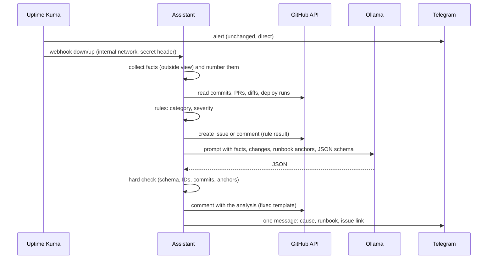

# vps-incident-assistant

[](https://github.com/PhilippKlinger/vps-incident-assistant/actions/workflows/ci.yml)
[](https://github.com/PhilippKlinger/vps-incident-assistant/actions/workflows/security.yml)
[](https://github.com/PhilippKlinger/vps-incident-assistant/actions/workflows/codeql.yml)
[](https://scorecard.dev/viewer/?uri=github.com/PhilippKlinger/vps-incident-assistant)

Incident assistant for the VPS platform: turns Uptime Kuma alerts into GitHub issues with rule-based triage and a checked local LLM analysis.

When a service goes down, the alert alone does not say what changed or where to look. The assistant collects the facts around the alert, files one issue per incident and adds a suspected cause and a matching runbook section, both backed by evidence. Rules decide category and severity; the LLM only suggests the cause, and the code checks every claim before it is published. A human decides what to do; the assistant only reads, and writes issues and Telegram messages.

The LLM is switched off (`llm.enabled = false` in `config.toml`) until the evaluation (OPS-03) shows that it beats simple baselines. Until then the issues contain the rule result only.

## How it works



**Rules vs. LLM.** Rules produce category and severity. The LLM never does; it only fills a fixed schema: `suspected_change`, `change_reasoning`, `runbook`, `runbook_reasoning`, `summary`, `evidence` and `confidence`. Runs use `temperature: 0`, thinking off, the schema as `format`, a 300 s timeout and one retry.

**Facts.** Every fact gets an ID (`F1`, `F2` ...), every change an ID (`C1` ... with repo and SHA), every runbook section an anchor (for example `vps-edge#troubleshooting-502`).

- Outside view: the Kuma payload plus the assistant's own check of the URL (HTTP status, selected headers, response time, TLS expiry, DNS).
- Deploy context: per repo the commits of the last 72 hours (at most 10), changed files, shortened diffs (2000 characters per change, 12000 in total) and the latest runs of the deploy workflow.
- Runbook: the `## Troubleshooting` section in the READMEs of `vps-edge`, `vps-monitoring` and `videoflix-deploy`.

**Evidence is mandatory.** The answer is discarded unless it passes the check: valid schema, and a change ID, runbook anchor and evidence IDs that exist in the supplied lists, with at least one piece of evidence. On a failed check, a timeout or an unreachable Ollama the assistant retries once and then comments that the analysis is not available; the rule result stays. The issue always calls the analysis a "Vermutung" (suspicion).

**Lifecycle.**

- One issue per incident and project. While an incident is open, alerts of further monitors of the project are added to the same issue. A repeated down of the same monitor within 10 minutes (`merge_window_minutes`) of the issue's last update counts as a duplicate delivery and is ignored; a later one is added as well. If a resolved issue goes down again within 10 minutes of its last update, it continues in the same issue and loses the label `resolved-pending-review` again; later it becomes a new incident. The state lives in GitHub labels (`incident`, `project:<name>`); the assistant has no storage of its own.
- The LLM runs once per incident; later alerts become comments with new facts.
- On "up" the assistant comments with the downtime and adds the label `resolved-pending-review`. It never closes an issue.
- At most 6 LLM runs per hour (`max_runs_per_hour`); above that the issue keeps the rule result and gets a comment that the analysis is unavailable because of the limit.
- Telegram: Kuma reports down and up itself. The assistant sends one message per incident once the analysis is done (without LLM: the issue link with the rule result). Same bot and chat as Kuma.

Issue and Telegram text is German.

## Security

| Risk | Measure |
|---|---|
| Prompt injection through changelogs (Dependabot), PR texts, foreign error messages | Model without tools; foreign text in delimited, shortened blocks marked as untrusted; hard check of the answer |
| Output as attack path (links, `@` mentions, HTML in issues) | Issue built from a fixed template; free text has links, `@`, Markdown images and HTML neutralized |
| Forged webhook | Internal Docker network only, no Caddy route, no published port; shared secret in the `X-Webhook-Secret` header, compared in constant time |
| Too many permissions | Two fine-grained tokens: read-only on the five source repos, and Issues write on the issue repo only. Fine-grained tokens give all selected repos the same rights, hence two |
| Secrets | Only in `.env` on the server (gitignored), `.env.example` in the repo, gitleaks in CI |
| Data leaving the host | Only public data in the prompt; no private repos, no logs, no Docker socket; Ollama has no internet access |
| Residual risk | A valid but wrong suspicion is possible. It is labelled as such; the decision stays with a human |

Container hardening: images pinned by digest, `cap_drop: [ALL]`, `no-new-privileges`, non-root users, read-only root filesystem for the assistant, journald logging, no published ports. CI starts the stack and checks these properties, scans the images with Trivy (exceptions for the pinned Ollama image are listed with reason and expiry in `.trivyignore.yaml`), audits the dependencies, runs CodeQL, Scorecard and gitleaks, and attests provenance and SBOM of the published image.

## Configuration

### Environment (`.env`, see `.env.example`)

| Variable | Required | Meaning |
|---|---|---|
| `WEBHOOK_SECRET` | yes | Shared secret Kuma sends in the `X-Webhook-Secret` header |
| `GITHUB_READ_TOKEN` | yes | Fine-grained token, read access to the five source repos |
| `GITHUB_ISSUE_TOKEN` | yes | Fine-grained token, Issues write on the issue repo only |
| `ISSUE_REPO` | yes | Repository the incident issues are created in |
| `TELEGRAM_BOT_TOKEN` | yes | Bot token for notifications |
| `TELEGRAM_CHAT_ID` | yes | Chat that receives the notifications |
| `OLLAMA_URL` | no | Ollama base URL, default `http://ollama:11434` |
| `OLLAMA_MODEL` | no | Model name, default `qwen3:8b` (also used by `ollama-pull`) |
| `ASSISTANT_IMAGE` | no | Overrides the image digest pinned in `compose.yaml` |

The assistant exits at startup if a required variable is missing.

### Projects (`config.toml`)

`config.toml` maps Uptime Kuma monitor names to projects, and projects to the repos used as context. A new project needs no code change.

```toml
[llm]
enabled = false          # switched on only after OPS-03 meets the thresholds
max_runs_per_hour = 6

[lifecycle]
merge_window_minutes = 10

[[projects]]
name = "videoflix"
display_name = "Videoflix"
monitors = ["Videoflix · Web-App", "Videoflix · API"]
repos = ["PhilippKlinger/videoflix-backend", ...]    # read for changes
runbook_repos = ["PhilippKlinger/vps-edge", ...]     # read for runbook sections
llm = true                                           # false: rule result only
```

Projects with `llm = true`: Videoflix and the status page. Portfolio, Neuro Check-in and Blog get issues with the rule result only. Alerts from a monitor that is not listed are filed under the project "unknown" without LLM.

## Usage on the server

The stack lives in `/srv/incident` next to the other stacks. `compose.yaml` pins the assistant image by digest; `.env` may override `ASSISTANT_IMAGE`.

1. Update `vps-monitoring` first (`docker compose up -d`). It creates the internal network `incident`, which this stack joins as an external network.
2. Create `/srv/incident` and put `compose.yaml` and `.env` there (`chmod 600 .env`). Create the model directory; Ollama runs as UID 1000 with the bind mount `./models:/models`:

   ```bash
   cd /srv/incident
   install -d -o 1000 -g 1000 models
   ```

3. Pull the images and download the model once. Only the one-off `ollama-pull` service (profile `setup`) has internet access; the running Ollama never does.

   ```bash
   docker compose pull
   docker compose --profile setup run --rm ollama-pull
   ```

4. Start the stack and check that the assistant is healthy:

   ```bash
   docker compose up -d
   docker compose ps
   ```

5. In Uptime Kuma add a webhook notification to `http://incident-assistant:8080/webhook/kuma` with the header `X-Webhook-Secret`, and press *Test*. The assistant log shows `ignored` for the test event. Create the monitor `Statusseite` if it does not exist yet.
6. Check Ollama's limits: during one run `docker stats` shows Ollama within 8 GiB and 2 CPUs, and five minutes later the model is unloaded (`docker compose exec ollama ollama ps` is empty).

A new model goes the same way: change `OLLAMA_MODEL` in `.env` and repeat the `ollama-pull` step.

Resources: the assistant gets 256 MB and 0.5 CPU. Ollama gets `cpus: 2`, `mem_limit: 8g` and a low `cpu_shares`, keeps one model loaded (`OLLAMA_MAX_LOADED_MODELS=1`), handles one request at a time (`OLLAMA_NUM_PARALLEL=1`) and unloads the model after 5 minutes (`OLLAMA_KEEP_ALIVE=5m`). If Ollama exceeds the limit, the kernel stops only Ollama.

## Limits

- If the whole VPS is down, there is neither a Kuma alert nor an analysis.
- An analysis can pass the check and still be wrong. The check proves that every ID, commit and anchor exists, not that the conclusion is right.
- A restart of the assistant resets the hourly LLM limit.
- Only public repos are read. Causes outside them (a provider outage, an expired certificate) show up as "no suspected change".
- The assistant sees only what is visible from outside and in the repos, not the host (logs, CPU, disk).

## Development

```bash
python -m venv .venv
source .venv/bin/activate   # Windows: .venv/Scripts/activate
pip install -r requirements-dev.txt

ruff check .
ruff format --check .
pytest
```
